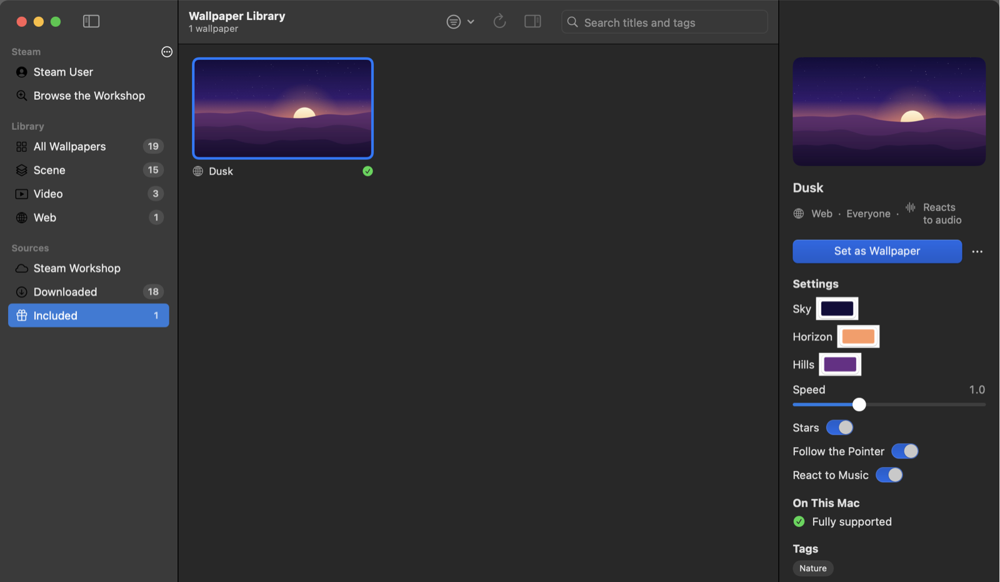
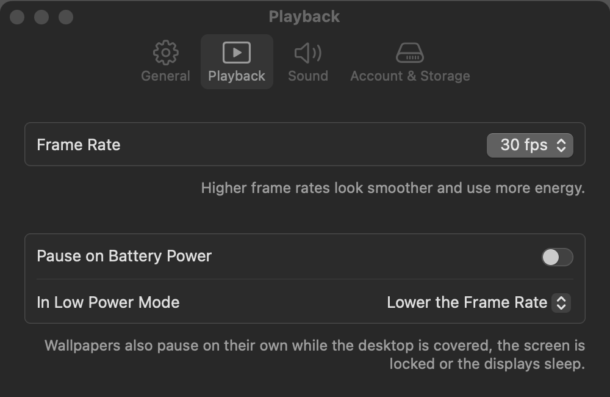

<div align="center">
  
  <h1>MacWallpaper</h1>
  <p><b>Your Wallpaper Engine wallpapers, alive on your Mac.</b></p>
  <p>A native macOS player for Wallpaper Engine scenes, videos and web wallpapers, built with Swift and Metal.</p>

  <p>
    <a href="https://github.com/Strangelight-Merser/mac-wallpaper/releases/latest"></a>
    <a href="https://github.com/Strangelight-Merser/mac-wallpaper/releases"></a>
    
    
    <a href="https://github.com/Strangelight-Merser/mac-wallpaper/actions/workflows/ci.yml"></a>
    <a href="LICENSE"></a>
  </p>

  <p>
    <a href="https://github.com/Strangelight-Merser/mac-wallpaper/releases/latest/download/MacWallpaper.zip"><b>Download</b></a> ·
    <a href="https://github.com/Strangelight-Merser/mac-wallpaper/releases">Releases</a> ·
    <a href="#faq">FAQ</a> ·
    <a href="README.zh-CN.md">简体中文</a>
  </p>
</div>


> [!NOTE]
> MacWallpaper plays wallpapers from **your own** copy of [Wallpaper Engine](https://store.steampowered.com/app/431960/)
> on Steam; you need to own it. MacWallpaper is not affiliated with Wallpaper Engine Team or Valve, and it ships no
> Wallpaper Engine content.

## Why MacWallpaper?

Wallpaper Engine has the largest collection of animated wallpapers anywhere, but it only runs on Windows. If you own
it and use a Mac, MacWallpaper lets you enjoy your wallpapers there too, the way a Mac app should work:

- **Native, not emulated.** No Wine, no Windows: scenes are rendered with Metal, videos are hardware-decoded, web
  wallpapers run in WebKit.
- **Uses what you already have.** Log in with Steam's QR code, and your subscriptions and Wallpaper Engine's files
  are downloaded from your own account and kept up to date.
- **Light on your Mac.** It pauses when the desktop is covered, the screen is locked or the displays sleep, and can
  pause on battery. A typical scene takes a few milliseconds of GPU time per frame.

## Install

1. [**Download MacWallpaper**](https://github.com/Strangelight-Merser/mac-wallpaper/releases/latest/download/MacWallpaper.zip) (the latest version; older ones are on the
   [Releases](https://github.com/Strangelight-Merser/mac-wallpaper/releases) page), unzip it and move **MacWallpaper** to your Applications folder.
2. Open it. The app isn't notarized by Apple yet, so the first time macOS blocks it: go to
   **System Settings → Privacy & Security** and click **Open Anyway**. (Or, in Terminal:
   `xattr -dr com.apple.quarantine /Applications/MacWallpaper.app`.)
3. Follow the welcome guide: log in to Steam, get Wallpaper Engine's files, pick wallpapers from your subscriptions.

Requires macOS 14 Sonoma or later on a Mac with Apple Silicon.

## Features

### Wallpapers

- [x] Scenes: image layers and effect chains, particles, text and clocks, sound, scripts (SceneScript)
- [x] Puppet animation, lights and volumetric light
- [x] Audio visualisation that follows what your Mac is playing
- [x] Mouse interaction: parallax, cursor effects, clicks in web wallpapers
- [x] Videos: H.264, HEVC, AV1, VP9 and VP8
- [x] Web wallpapers with Wallpaper Engine's JavaScript API
- [x] Each wallpaper's settings (colours, sliders, pictures), applied live
- [x] Presets and your own pictures in scenes that allow them
- [ ] 3D model objects in scenes
- [ ] Sound in video wallpapers

### Library and Steam

- [x] Log in with Steam's QR code (or password and Steam Guard)
- [x] Import your subscriptions; updates are checked and installed safely
- [x] Browse, search and subscribe to the Steam Workshop inside the app, with small previews to save data
- [x] Use folders copied from a Windows PC
- [x] A compatibility check for every wallpaper: you see what runs fully before you choose it
- [ ] Favourites and playlists

### Mac

- [x] Lives in the Dock, the menu bar, or both; right-click the Dock icon for quick controls
- [x] A settings window; open at login
- [x] Pause on battery or in Low Power Mode, or lower the frame rate instead
- [x] Fill, fit or stretch
- [x] English and Simplified Chinese
- [ ] A different wallpaper on each display
- [ ] Automatic app updates

## Gallery

#### Your library, with each wallpaper's settings



#### Settings



## FAQ

<details>
<summary><b>Do I need Wallpaper Engine?</b></summary>

Yes. MacWallpaper uses Wallpaper Engine's own files (its shaders and effects) and the wallpapers you subscribe to,
both downloaded with your Steam account. It doesn't include or share any of them.
</details>

<details>
<summary><b>macOS says it can't check the app for malicious software.</b></summary>

The app isn't notarized yet (that needs a paid Apple developer account). Open it once, then allow it in
**System Settings → Privacy & Security → Open Anyway**. You can also build it yourself from source.
</details>

<details>
<summary><b>Is my Steam account safe?</b></summary>

MacWallpaper logs in the same way the Steam mobile app does: you approve the login with Steam's QR code (or your
password and Steam Guard), and Steam lists MacWallpaper among your authorized devices, where you can remove it at any
time. The login is stored in your Mac's Keychain, and the app only talks to Steam.
</details>

<details>
<summary><b>Some of my wallpapers don't play correctly.</b></summary>

Every wallpaper in the library shows whether it runs fully on your Mac and, if not, what's missing. 3D models aren't
supported yet. If a wallpaper marked as supported looks wrong, please
[open an issue](https://github.com/Strangelight-Merser/mac-wallpaper/issues) with its Workshop link.
</details>

<details>
<summary><b>How much battery does it use?</b></summary>

Wallpapers stop drawing whenever you can't see them (covered desktop, locked screen, sleeping displays). In
**Settings → Playback** you can choose the frame rate and pause on battery or in Low Power Mode.
</details>

<details>
<summary><b>Does it work on Intel Macs or older macOS versions?</b></summary>

No. MacWallpaper needs Apple Silicon and macOS 14 or later.
</details>

<details>
<summary><b>Why does audio visualisation need the Screen Recording permission?</b></summary>

macOS only lets apps hear system audio through its screen-capture framework. MacWallpaper reads the audio spectrum
and nothing else: no picture, nothing recorded or saved. It's off until you turn it on.
</details>

## Building from source

Needs Xcode 26.3 or later (Swift 6.2).

```bash
git clone --recurse-submodules https://github.com/Strangelight-Merser/mac-wallpaper.git
cd mac-wallpaper
./scripts/build.sh
open .build/MacWallpaper.app
```

- `swift test` runs the tests. `scripts/regress.sh` compares renders with reference images; it needs Wallpaper
  Engine's files and sample wallpapers in `samples/` (not part of the repository).
- `wecli`, built alongside, renders wallpapers to images, inspects Wallpaper Engine's formats and talks to Steam; run
  it without arguments for help.
- How everything works, with design decisions and findings, is written up (in Chinese) in [docs/design.md](docs/design.md).

## Contributing

Bug reports and ideas are welcome in [Issues](https://github.com/Strangelight-Merser/mac-wallpaper/issues): for a
wallpaper that looks wrong, include its Workshop link and a screenshot. Pull requests are welcome too; please open an
issue first for larger changes.

## Acknowledgements

MacWallpaper stands on the work of [linux-wallpaperengine](https://github.com/Almamu/linux-wallpaperengine),
[RePKG](https://github.com/notscuffed/repkg), [node-steam-user](https://github.com/DoctorMcKay/node-steam-user),
[glslang](https://github.com/KhronosGroup/glslang), [SPIRV-Cross](https://github.com/KhronosGroup/SPIRV-Cross) and
[Zstandard](https://github.com/facebook/zstd). See [THIRD_PARTY_NOTICES.md](THIRD_PARTY_NOTICES.md) for details.

## License

MacWallpaper is free software under the [GPL-3.0](LICENSE).
