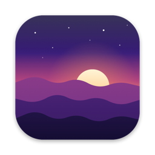
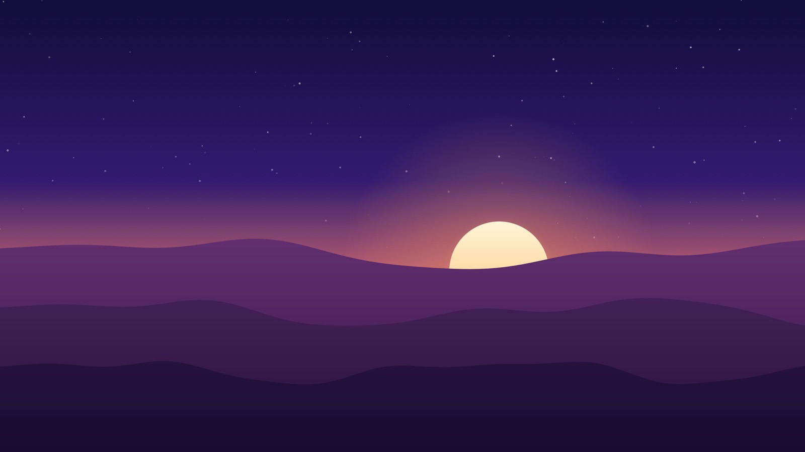
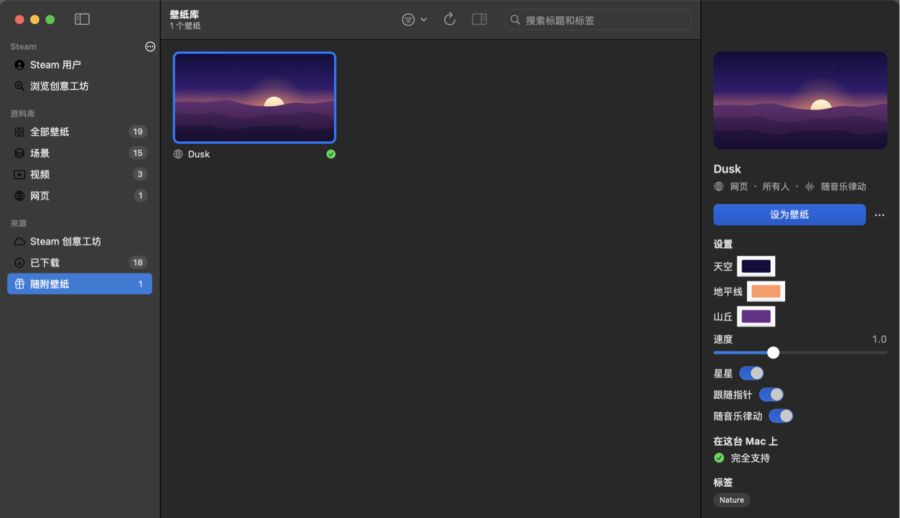
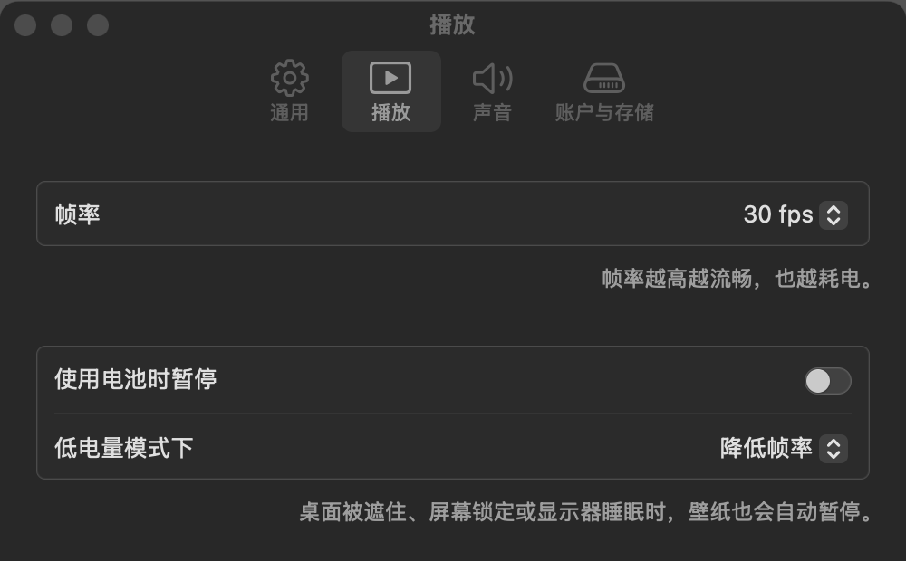

<div align="center">
  
  <h1>MacWallpaper</h1>
  <p><b>让你的 Wallpaper Engine 壁纸，在 Mac 上动起来。</b></p>
  <p>原生的 macOS 壁纸播放器，支持 Wallpaper Engine 的场景、视频和网页壁纸，用 Swift 和 Metal 打造。</p>

  <p>
    <a href="https://github.com/Strangelight-Merser/mac-wallpaper/releases/latest"></a>
    <a href="https://github.com/Strangelight-Merser/mac-wallpaper/releases"></a>
    
    
    <a href="https://github.com/Strangelight-Merser/mac-wallpaper/actions/workflows/ci.yml"></a>
    <a href="LICENSE"></a>
  </p>

  <p>
    <a href="https://github.com/Strangelight-Merser/mac-wallpaper/releases/latest/download/MacWallpaper.zip"><b>下载</b></a> ·
    <a href="https://github.com/Strangelight-Merser/mac-wallpaper/releases">所有版本</a> ·
    <a href="#常见问题">常见问题</a> ·
    <a href="README.md">English</a>
  </p>
</div>



> [!NOTE]
> MacWallpaper 播放的是**你自己** Steam 账号里 [Wallpaper Engine](https://store.steampowered.com/app/431960/) 的壁纸，
> 你需要拥有 Wallpaper Engine。MacWallpaper 与 Wallpaper Engine 开发团队及 Valve 没有任何关系，也不附带任何
> Wallpaper Engine 的内容。

## 为什么用 MacWallpaper？

Wallpaper Engine 拥有世界上最多的动态壁纸，却只能在 Windows 上运行。如果你买了它、又在用 Mac，MacWallpaper
能让你在 Mac 上继续享受这些壁纸，而且用起来就像一款地道的 Mac 应用：

- **原生运行，不靠模拟。** 不用 Wine，也不用 Windows：场景用 Metal 渲染，视频用硬件解码，网页壁纸跑在 WebKit 里。
- **直接用你已有的。** 用 Steam 扫码登录，你的订阅和 Wallpaper Engine 的文件会从你自己的账号下载，并保持更新。
- **对 Mac 很友好。** 桌面被遮挡、锁屏或显示器睡眠时自动暂停，也可以在用电池时暂停。常见的场景每帧只占几毫秒 GPU。

## 安装

1. [**下载 MacWallpaper**](https://github.com/Strangelight-Merser/mac-wallpaper/releases/latest/download/MacWallpaper.zip)（最新版本；旧版本在[所有版本](https://github.com/Strangelight-Merser/mac-wallpaper/releases)页面），
   解压后把 **MacWallpaper** 拖进“应用程序”文件夹。
2. 打开它。应用暂时没有经过 Apple 公证，第一次打开会被 macOS 拦下：到**系统设置 → 隐私与安全性**里点**仍要打开**。
   （也可以在“终端”里运行 `xattr -dr com.apple.quarantine /Applications/MacWallpaper.app`。）
3. 跟着欢迎页走：登录 Steam、获取 Wallpaper Engine 的文件、从你的订阅里挑选壁纸。

需要搭载 Apple 芯片的 Mac，macOS 14 Sonoma 或更新版本。

## 功能

### 壁纸

- [x] 场景：图层与特效链、粒子、文字和时钟、声音、脚本（SceneScript）
- [x] 木偶动画、灯光和体积光
- [x] 随音乐律动，跟着 Mac 正在播放的声音变化
- [x] 鼠标交互：视差、光标特效、网页壁纸里的点击
- [x] 视频：H.264、HEVC、AV1、VP9 和 VP8
- [x] 带 Wallpaper Engine JavaScript 接口的网页壁纸
- [x] 每个壁纸的设置（颜色、滑块、图片），改了立即生效
- [x] 预设，以及在允许的场景里换上你自己的图片
- [ ] 场景里的 3D 模型对象
- [ ] 视频壁纸的声音

### 壁纸库与 Steam

- [x] 用 Steam 扫码登录（也可以用账号密码 + Steam 令牌）
- [x] 导入你的订阅；自动检查并安全地安装更新
- [x] 在应用里浏览、搜索和订阅创意工坊，预览图只取小图以节省流量
- [x] 使用从 Windows 电脑拷来的文件夹
- [x] 每个壁纸都有兼容性检查：选之前就知道能不能完整运行
- [ ] 收藏和播放列表

### Mac

- [x] 显示在程序坞、菜单栏或两者；右键点按程序坞图标即可快速控制
- [x] 设置窗口；开机自启
- [x] 用电池或低电量模式时暂停，或者改为降低帧率
- [x] 铺满、完整显示或拉伸
- [x] 简体中文和英文
- [ ] 每块显示器显示不同的壁纸
- [ ] 应用自动更新

## 截图

#### 壁纸库，以及每个壁纸的设置



#### 设置



## 常见问题

<details>
<summary><b>必须拥有 Wallpaper Engine 吗？</b></summary>

是的。MacWallpaper 要用到 Wallpaper Engine 自己的文件（着色器和特效）以及你订阅的壁纸，两者都用你的 Steam 账号下载。
它本身不包含、也不分发其中任何内容。
</details>

<details>
<summary><b>macOS 提示“无法验证开发者”或“无法检查其是否包含恶意软件”。</b></summary>

应用暂时没有经过公证（这需要付费的 Apple 开发者账号）。先打开一次，再到**系统设置 → 隐私与安全性**里点**仍要打开**。
你也可以从源码自己编译。
</details>

<details>
<summary><b>我的 Steam 账号安全吗？</b></summary>

MacWallpaper 的登录方式和 Steam 手机 App 一样：你用 Steam 的二维码（或账号密码加 Steam 令牌）确认登录，之后 Steam 会把
MacWallpaper 列在你的授权设备里，你随时可以在那里移除它。登录信息保存在 Mac 的钥匙串中，应用只和 Steam 通信。
</details>

<details>
<summary><b>有些壁纸显示不正常。</b></summary>

壁纸库里每个壁纸都会显示能否在你的 Mac 上完整运行，不能的话缺什么。3D 模型暂时不支持。如果标为支持的壁纸看起来不对，
欢迎[提交 Issue](https://github.com/Strangelight-Merser/mac-wallpaper/issues)，附上它的创意工坊链接。
</details>

<details>
<summary><b>会很耗电吗？</b></summary>

只要你看不到壁纸（桌面被遮挡、锁屏、显示器睡眠），它就不会绘制。在**设置 → 播放**里可以选择帧率，以及用电池或
低电量模式时暂停。
</details>

<details>
<summary><b>支持 Intel Mac 或更早的 macOS 吗？</b></summary>

不支持。MacWallpaper 需要 Apple 芯片和 macOS 14 或更新版本。
</details>

<details>
<summary><b>随音乐律动为什么需要“录屏”权限？</b></summary>

macOS 只允许应用通过屏幕录制框架获取系统声音。MacWallpaper 只读取音频频谱，不读取画面，也不录制或保存任何内容。
这个功能默认关闭，打开后才会使用。
</details>

## 从源码构建

需要 Xcode 26.3 或更新版本（Swift 6.2）。

```bash
git clone --recurse-submodules https://github.com/Strangelight-Merser/mac-wallpaper.git
cd mac-wallpaper
./scripts/build.sh
open .build/MacWallpaper.app
```

- `swift test` 运行测试。`scripts/regress.sh` 把渲染结果和参考图对比，需要 `samples/` 里的 Wallpaper Engine 文件和
  示例壁纸（不在仓库里）。
- 同时编译出的 `wecli` 可以把壁纸渲染成图片、检查 Wallpaper Engine 的各种格式、和 Steam 交互，不带参数运行即可查看帮助。
- 工作原理、设计取舍和各种发现，都写在 [docs/design.md](docs/design.md) 里。

## 参与贡献

欢迎在 [Issues](https://github.com/Strangelight-Merser/mac-wallpaper/issues) 里报告问题、提出想法：如果是某个壁纸
显示不对，请附上它的创意工坊链接和截图。也欢迎提交 Pull Request；较大的改动请先开 Issue 讨论。

## 致谢

MacWallpaper 建立在这些项目的基础上：[linux-wallpaperengine](https://github.com/Almamu/linux-wallpaperengine)、
[RePKG](https://github.com/notscuffed/repkg)、[node-steam-user](https://github.com/DoctorMcKay/node-steam-user)、
[glslang](https://github.com/KhronosGroup/glslang)、[SPIRV-Cross](https://github.com/KhronosGroup/SPIRV-Cross) 和
[Zstandard](https://github.com/facebook/zstd)。详见 [THIRD_PARTY_NOTICES.md](THIRD_PARTY_NOTICES.md)。

## 许可证

MacWallpaper 是基于 [GPL-3.0](LICENSE) 的自由软件。
